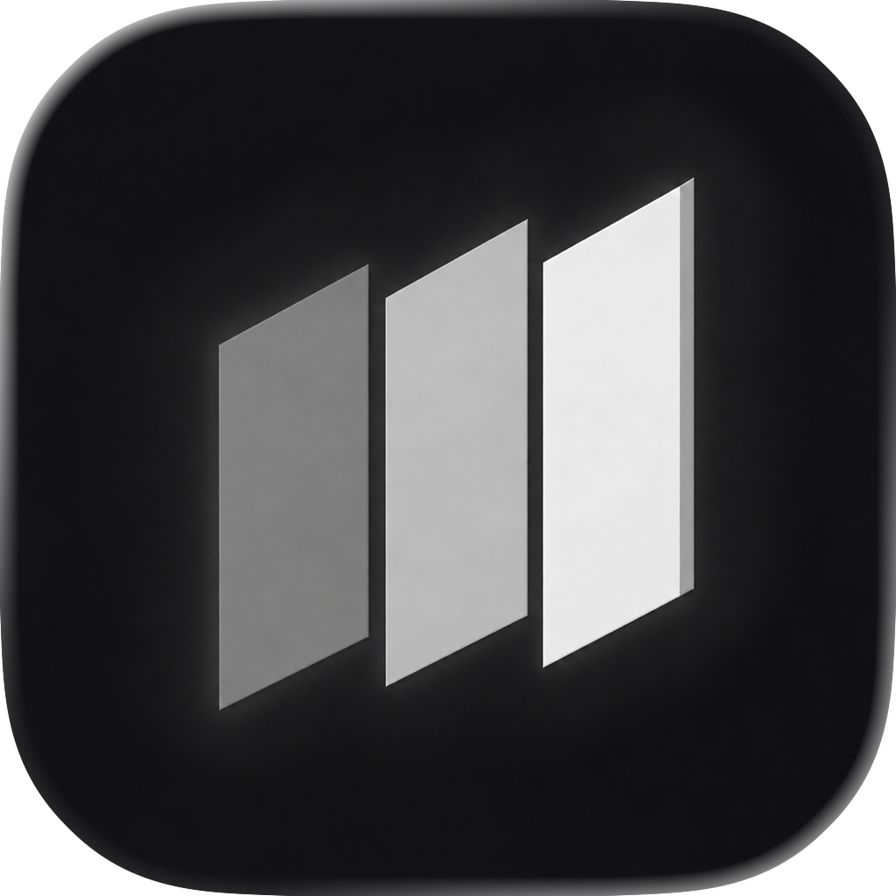

# FFFilm

**English** | [简体中文](README.md)

Data rate, storage runtime and shutter planning for the camera you actually have on set, plus film simulation on iPhone / iPad and film slicing on macOS. Native SwiftUI on iPhone, iPad and Mac, with no third-party dependencies.

## Features

**Recording** — camera, format and cadence in; rate and storage out.

- Data rate as GB/h or GiB/h, with the matching Mb/s bitrate.
- Storage plan: capacity for a planned duration, the card's actual capture runtime, and a warning when the plan exceeds the card.
- Plan 0–24 hours using the iOS seconds wheel or decimal hours on Mac. Incomplete Mac plans pause add and copy actions.
- Group estimates by project, shooting day and rig. Each entry keeps its original format, figures and units. Add the planned duration from capacity mode or one card from runtime mode. Duplicate entries count toward the total.
- Per-camera format memory. Media and planned duration stay per-window.
- Choose the recording format first, then enter the storage plan. The result panel has no technical-details section.

ALEXA 35 Open Gate ARRIRAW uses manufacturer card-runtime references of 28 / 56 minutes at 24 fps for 1 TB / 2 TB Compact Drives. HDE is an offload estimate. FX6, VENICE 2 and V-RAPTOR XL expose catalogued internal recording profiles. Some modes have a 24 fps reference only. Unverified modes and generic estimates are identified separately. A configuration link opens a preview on the receiving device before adoption. [ARRI manual](https://www.arri.com/resource/blob/389818/03a1421ba039d246cd4c895c2f791f79/alexa-35-user-manual-sup-4-0-0-data.pdf) · [Sony X-OCN tables](https://pro.sony/s3/2023/09/11132750/Sony_X-OCN_WhitePaper_Sep20231.pdf) · [FX6 specifications](https://pro.sony/ue_US/products/handheld-camcorders/ilme-fx6) · [RED recording formats](https://docs.red.com/955-0203/955-0203_V1.7%20Rev-B%20RED%20PS%2C%20V-RAPTOR%20XL%208K%20VV%20Operation%20Guide%20HTML/Content/B_TechSpecs/Specs_V-RAPTOR_XL.htm)

The default day follows the local date. A manually started shooting day stays open across midnight. Starting a new day archives the previous handoff for viewing and copying. Legacy settings-only entries migrate by their original date and distinguish reconstructed estimates from unavailable historical figures.

**Shutter** — three modes sharing camera FPS and a user-set maximum angle.

- **Convert** — angle ⇄ exposure time, with the primary readout following the conversion direction.
- **Flicker reference** — optical-cycle model candidates for mains (50/60 Hz), a custom optical rate, or 2–16 display refresh rates. Adopt a candidate directly and inspect its relative exposure difference; test footage is still required.
- **Frame rate (over / undercrank)** — match by keeping angle or exposure time, with playback speed and an optional light check. Over-limit results include both the theoretical target and achievable exposure at the limit.

Preset frame rates carry their exact rational values; typed decimals stay literal.

DIT shortcuts expose common FPS, angles and exposure times; time input accepts `1/50`, `20 ms` and `0.02 s`. Independent A/B/C camera slots retain settings and camera/mode notes, including window-local drafts while switching. Saved setups and the latest 12 distinct calculations restore to their source camera slot. Field-check conditions and notes are user-recorded observations, not automatic flicker detection.

**Camera catalog** — 39 profiles across ARRI, Sony, RED, DJI, Kinefinity and standalone Apple ProRes, with manufacturer-grouped search, reorderable favorites and per-camera recording-mode details.

**Settings** — decimal GB/TB or binary GiB/TiB, applied to rates and totals without changing bitrate or runtime. Switch between Simplified Chinese and English in the app, with immediate updates and a saved preference. The initial language follows supported system preferences, falling back to English; camera models, codec names and FPS stay in their source form.

## Film Simulation (iPhone / iPad)

Open **Film Simulation** and import from the photo library or Files (TIFF / JPEG / PNG / HEIC / HEIF, including large 8/16-bit RGB or grayscale images); other apps can also hand images straight to FFFilm through the system Open-in flow — cold launches included, and a failed import keeps the current source. Zooming sharpens the preview on demand within the source dimensions and memory budget.

The camera offers a lens choice (an automatic multi-lens camera with macro takeover, or explicit ultra-wide / wide / telephoto) and 720p / 1080p / 4K capture, with tap-to-focus where the hardware allows it. Exposure and white balance lock for live positive preview; frozen exports use the video frame dimensions.

Choose the **input type** at the top of the camera or file workbench. For color or black-and-white negatives, choose **Calibrate & invert**, select an unexposed edge and confirm. Before calibration the source stays visible for finding a film edge, and you can preselect a look. Confirmation automatically inverts the negative and applies the selected look to the result. Slides and ordinary camera scenes use the original image as the starting point for simulation. The app remembers the input type. Resample for a different roll; switching input types or optical configurations invalidates calibration.

The camera fills the screen and reveals the complete frame during sampling. The first thumbwheel stop, **Standard**, shows the calibrated positive for a negative, neutral grayscale for a calibrated black-and-white negative, or the original slide or scene. Turn the wheel to choose from three general looks and approximations of PORTRA 400, EKTAR 100, EKTACHROME E100 and TRI-X 400. In **Film looks**, drag the slider or use the +/− buttons to set strength from 0–100% in 5% steps. Each look remembers its own setting. On live, frozen or imported images, **Compare original** temporarily shows the source before inversion and styling. Returning to simulation restores the selected look and strength. Returning from the camera to review keeps the last frame and its look. Each Kodak look links to its official technical data sheet. [Film look profiles](docs/film-look-profiles.md)

Share the full-size neutral positive for negatives or the unstyled original image for slides as 16-bit sRGB TIFF / PNG or 8-bit sRGB JPG. JPG can also be saved to Photos with add-only permission. Processing stays on-device and preserves the input file. Multi-page and floating-point TIFF inputs are unsupported.

See the [implementation notes](docs/ios-negative-film-preview.md) for simulator evidence and outstanding real-device validation of large-file limits and camera behavior.

## Film slicing (macOS only)

Open **Film** in the Mac toolbar, or press **⌘3**. Drop or import a TIFF / experimental Flextight FFF scan, detect frames and conservatively fit their four edges, or draw frames manually, then crop, rotate, reorder and export. Scan dimensions and sprockets identify 135, 120 or large format; select a format manually when detection is uncertain. **Add frame** joins the previous frame and sizes the new slice for the film format. Without reliable gaps, 120 starts at 6×6 and subsequent frames inherit the preceding frame's height. Automatic identification and boundaries are candidates and should be checked. Save `.ffbatch` batches to restore multiple scans, crops, ordering, checks and review status. Existing single-scan `.fffilm` projects still open; source scans are never modified.

Automatic selection identifies stable dark scanner margins and combines strip-wide aperture evidence with per-frame edges to remove broad black borders; it does not discard dark subjects using a whole-image brightness threshold. It reuses import analysis, checks long scans in overlapping segments, and refines uncertain edges from source-precision pixels. Use **Sample film base** in the canvas tool picker or **Calibrate from current frame** to help refine other automatic frames. Repeat detection preserves manual edits and identifies edges needing review. Sampling and calibration are session-only; final crops are saved in the project. Automatic transport pitch stays separate from the trimmed image width when adding a frame. See the [validation record](docs/film-detection-validation.md) for test and performance evidence.

Export current, checked or all frames as 16-bit Adobe RGB TIFF or 8-bit sRGB JPEG. Whole-strip output places rotated crops in their original slots, clipping to the slot boundaries; individual exports retain full rotated bounds. Zoom, undo/redo and batch selection remain available.

Select or drop multiple scans at once; later imports append to the batch. Click a scan to edit it and use its checkbox for batch actions. Each scan retains independent undo history, viewport, base samples and calibration. Imports run sequential automatic detection by default; turn it off, detect checked scans or assign their film format from Batch actions. **Mark reviewed and next** advances through review; automatic detection never marks a scan reviewed. Untagged files wait for explicit input-profile assignment while other scans continue. Failed scans can be retried or located again.

Choose **Export checked scans…** to export the current, checked or all scans, with all frames, each scan's checked frames or whole-strip output. Current-scan export also retains the current-frame option. **File organization** offers one folder per scan or direct output into the destination. Source filename prefixes are the default; relative-path previews and collision handling cover the entire batch and existing files. Scans without matching frames are explicitly skipped without creating empty folders. Cancellation preserves completed files; resume remaining items or retry failures without repeating successful output. Switching scans preserves the batch job. Scans in a running export are locked for editing; other scans remain editable. Save the `.ffbatch` to retain delivered frames, the latest export job, and the destination bookmark. On reopening, FFFilm checks each completed output against its full-file SHA-256 digest. Missing outputs can be resumed. Changed files and existing outputs from older jobs without a full digest require review. If a scan has moved, use **Locate** before resuming. See the [export framework contract](docs/film-export-framework.md).

**Color management** remains for accurate input/output interpretation: embedded input profiles take precedence; untagged scans require explicit assignment or a matching RGB ICC. Floating-point previews preserve extended RGB and exports embed their output profiles. No automatic negative conversion is applied. See [color-management notes](docs/film-color-management.md).

**FFF compatibility is experimental:** ImageIO full-resolution 16-bit RGB decoding works for the tested sample, but this does not establish every proprietary variant or calibrated scanner color. Camera RAW FFF and FlexColor processing history are not supported.

## Build, run and test

Requires Xcode 26.3 or later, and iOS/iPadOS 18.6+ or macOS 15.6+. Open `FFFilm.xcodeproj`, or use:

```sh
# macOS app
xcodebuild -project FFFilm.xcodeproj -scheme FFFilm \
  -destination 'platform=macOS' build

# iOS Simulator
xcodebuild -project FFFilm.xcodeproj -scheme FFFilm \
  -destination 'platform=iOS Simulator,name=iPhone 17 Pro' build
```

```sh
# Unit tests — catalog integrity, rate tables, media planning, shutter math and the negative renderer
xcodebuild -project FFFilm.xcodeproj -scheme FFFilm \
  -destination 'platform=macOS' -only-testing:FFFilmTests test

# UI tests — run on a simulator; the flag avoids a clone-launch flake
xcodebuild -project FFFilm.xcodeproj -scheme FFFilm \
  -destination 'platform=iOS Simulator,name=iPhone 17 Pro' \
  -parallel-testing-enabled NO -only-testing:FFFilmUITests test
```

Tests retain distinct responsibilities:

| Area | Test files | Retained coverage |
| --- | --- | --- |
| Rates and catalog | `FFFilmTests`, `KinefinityTests`, `SonyMirrorlessTests` | Published numeric anchors, camera compatibility, capture/playback cadence |
| Calculator state | `CalculatorStoreTests`, `StorageUnitTests`, `QuickStartOrderTests` | Reset/undo, window isolation, unit boundaries, persistent favorites |
| Shutter | `ShutterTests`, `DITShutterTests`, `ShutterWorkspaceTests` | Mathematical boundaries, independent reference calculations, parsing, rigs and history |
| macOS film | `FilmTests`, `FilmFormatTests`, `FilmFrameDetectionTests`, `FilmRefinementTests`, `FilmZoomTests`, `FilmExportTests` | Cropping/detection, source precision, zoom, document state, safe export and recovery |
| Negative and camera | `NegativeTests`, `NegativeStoreTests`, `NegativeCameraPerformanceTests` | Color/orientation/depth, cancellation and resource lifetime, camera state and GPU buffers |
| Language and UI | `AppLanguageTests`, `FFFilmUITests`, `NegativeUITests` | Translation resources, platform privacy configuration, essential interactions and layout |

A bug fix does not automatically require a new test. Check existing coverage first and prefer updating a case or adding assertions to the same scenario. Add a case only for a missing critical behavior, independent failure path, or boundary. UI tests verify control wiring and complete user workflows; numerical combinations belong in unit tests. A dedicated language-switching workflow covers localization instead of repeating business flows per language. Assertion-free launch screenshots, launch benchmarks without a baseline, and tests of test-only helpers are excluded from regular regression coverage.

UI tests prefer accessibility identifiers and pin the language when checking copy. macOS film tests and iOS camera tests compile conditionally; a macOS-only run does not cover iOS. Use an available simulator name from `xcrun simctl list devices available`. The large TIFF stress test is opt-in through `NEGATIVE_LARGE_TEST=1` and remains off for ordinary runs. Pass `-resultBundlePath` to `xcodebuild` to preserve evidence; UI screenshots are stored in the `.xcresult` bundle.

```sh
# macOS app lifecycle
script/build_and_run.sh            # build and launch
script/build_and_run.sh --verify   # confirm the process is running
script/build_and_run.sh --debug    # launch under lldb
script/build_and_run.sh --logs     # stream the unified log
```

## License

This project is licensed under the GNU Affero General Public License v3.0 only (SPDX: `AGPL-3.0-only`). See [LICENSE](LICENSE) for the full terms.
